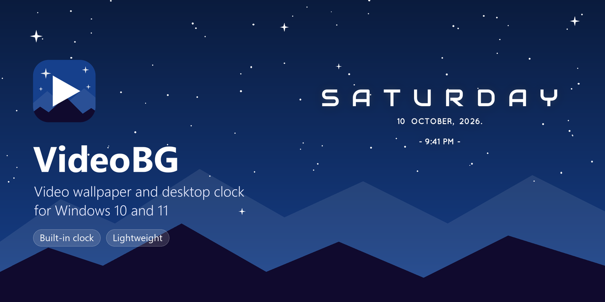

<p align="center">
  
</p>

<p align="center">
  <a href="https://github.com/Skyblock127/VideoBG/releases/latest"></a>
  <a href="https://github.com/Skyblock127/VideoBG/releases"></a>
  
  
</p>

<p align="center">
  <a href="https://github.com/Skyblock127/VideoBG/releases/latest"><b>⬇ Download the latest version</b></a>
  ·
  <a href="#update-to-a-new-version">How to update</a>
</p>

VideoBG plays a video behind your desktop icons and adds a desktop clock. It's one small exe:
your graphics chip decodes the video, the wallpaper pauses when nobody can see it, and switching
it off stops the video part completely.

## Features

- **Any video Windows can play:** MP4, MOV, MKV, WebM, AVI and more. VideoBG turns animated GIFs
  into a video once and then uses that.
- **`Ctrl + Alt + B`** turns the wallpaper on and off.
- **Light on your PC:** decoding runs on the GPU, and the wallpaper pauses while apps cover the
  desktop, the PC is locked or the screen is off.
- **Video versions:** lighter copies of a video (screen size, 900p, 720p, 540p) when you want
  it to use less memory.
- **Crop:** choose which part of the video fills the screen, in your screen's shape or any shape (stretched to fit).
- **Desktop clock:** day, date and time, which you can drag anywhere, in a style of your choice:
  the Mond text clock (four fonts included, or any font of your own), a dial, a ring, flip tiles,
  stacked digits, a single line or a big time. Your own colour, size, opacity, glow and language.
  Save looks as presets and use them on any clock.
- **Lock screen:** while the wallpaper is on, the lock screen shows a frame of the video.
- **Sound:** silent, the video's own sound, or your own music with a player: play/pause, seek, next/previous, shuffle, repeat, and a playlist you can rearrange. A music player can sit on your desktop too: a turning record, a cassette, a disc or bars that move with the sound.
- **Clear errors:** if a video won't play, VideoBG says why and gives you the fix.

## Install

You'll need 64-bit Windows 10 or 11. VideoBG doesn't need admin rights.

1. Download the zip (for example **VideoBG-1.5.1.zip**) from the
   **[latest release](https://github.com/Skyblock127/VideoBG/releases/latest)**.
2. Right-click the zip and choose **Extract All**. Extract it somewhere it can stay, for example
   `C:\Tools`. You get a **VideoBG** folder there (`C:\Tools\VideoBG`), and VideoBG runs from it.
3. Double-click **Install.cmd** in the VideoBG folder. It adds VideoBG to the Start menu and your startup apps, then
   opens it.
   - If Windows says *"Windows protected your PC"*, click **More info**, then **Run anyway**. The
     warning appears only because the app isn't code-signed.
4. Click **Choose video** and pick a video.

VideoBG then lives in the tray (notification area). Click its icon to open the settings.

## Update to a new version

Already have VideoBG? You don't need to uninstall. Your settings are kept.

1. Download the new zip from the **[latest release](https://github.com/Skyblock127/VideoBG/releases/latest)**.
2. Right-click the VideoBG icon in the tray and choose **Exit**.
3. Extract the zip to the same place as before: the folder that holds your VideoBG folder (for
   example `C:\Tools`). Choose **Replace the files**.
4. Double-click **Install.cmd** in the VideoBG folder again.

If you extract it somewhere else instead, run **Install.cmd** from there: VideoBG then runs from the
new folder, and you can delete the old one.

The version you have is shown at the bottom left of VideoBG's settings window. What changed in
each version is on the [releases page](https://github.com/Skyblock127/VideoBG/releases).

## Uninstall

Double-click **Uninstall.cmd** in the VideoBG folder. It puts your own lock screen picture back
and asks whether to delete your settings too. Then delete the folder.

## How to use

| Where | What you can do |
|---|---|
| `Ctrl + Alt + B` | Turn the wallpaper on or off. The tray menu does the same. |
| **Video** | **Choose video**, or pick one of **Your wallpapers** (the videos you switch between, with their pictures; add videos or take one off the list). **Crop** it, and pick the lock screen frame with the **Preview** slider (the wallpaper holds on that frame, and plays on a second after you let go). **Versions** makes lighter copies. |
| **Desktop clock** | Drag the clock on the preview to place it. Choose its **style** (each shown as it looks: Mond in any font, Dial, Ring, Flip, Stack, Line, Big), text and glow colours, size, opacity, glow, date style, language (any language Windows knows) and 12/24-hour time; what a style doesn't show (a dial has no 12/24-hour time) is greyed out. Set it up separately for the video wallpaper and your still wallpaper, and give a video its own clock with **This video**. **Show / Hide** turns it on or off for each. **Presets** keeps up to 5 clock looks you can edit, rename and use on any of these. |
| **Sound** | Nothing (the default), the video's sound, or your own songs. **My music** has a player (play/pause, seek bar, previous/next, shuffle, repeat one song) and a playlist: click a song to play it, or drag it by its grip to move it. Moving songs counts as shuffling; turning shuffle off goes back to the order you chose them in. **On the desktop** picks the music player shown on your desktop while My music plays (each style is shown as it looks). |
| **Playback** | Speed, a frame-rate cap, and which displays to use. Every display shows the same video, so more displays hardly add memory; versions are sized for the largest one. On laptops with two graphics chips, **Graphics chip** picks power saving or high performance. Under **Power saving**: pause when apps cover the desktop, and what to do on battery. |
| **General** | Change the hotkey and the **pause / mute sound** shortcut (Pause/Break by default: plays or pauses My music, mutes the video's audio), choose whether the wallpaper starts on, find your data folders, and send **Feedback**: suggest a feature or report a problem (no account needed; a report can include the app's log, with your user name and file names taken out). |

### Modern look

Switch the look at the top of the settings (**Classic** / **Modern**). In the modern look,
`Ctrl + Alt + B` (or the tray icon) brings your wallpapers up as a deck of cards that rises from
the bottom of the screen, over a full-screen view of the wallpaper:

- Scroll (a touchpad works too), drag the deck or use the arrow keys. The wallpaper shows each
  one's picture at once, and its video starts after a moment on it.
- **Enter** or a click on the middle card (once the deck has stopped on it) makes it your
  wallpaper: the card comes forward and glows, its picture turns into the video playing and its
  "Current" badge pops in; then the card fades away around the video, which grows smoothly to fill
  the screen. **Esc** closes and keeps the one you had.
- **Right-click the middle card** for its actions: the red **bin** (click it again, once it's a
  tick, to take the video off the list; the file isn't touched), its **versions** (the original and
  any lighter ones; pick which one plays) and, for your wallpaper, **crop**: drag and scroll right
  on the screen, and choose the picture for your lock screen (the wallpaper waits on that frame while
  you drag). A video's versions share one card, which shows the size of the version it plays.
- **Clock**: drag the clock right on your desktop, with all its settings beside it (style and date
  step through with the arrows; language, colours, size, glow, time). Each colour has an eyedropper (point at your wallpaper: the clock takes
  the colour as you move) and a grid for any colour. It's this video's own clock. Its arrow sends
  the panel to the other side; the eye hides everything to take a look.
- **Music**: play, pause, skip, shuffle, repeat and the volume, your **playlist** (click a song to
  play it, drag its grip to move it, or choose songs), and a **music player on your desktop**
  (behind your apps, with the song, its cover, its controls and the volume; drag it to move it):
  step through its styles and see it right there.
- **Settings** (or a right-click anywhere else): add videos, the lock screen, the wallpaper off,
  all the settings, or back to the classic look.

The classic settings window stays as it is in both looks: what's deeper (playback, power, the
shortcuts, what plays) is set there, it can do everything the picker does, and both looks always
show the same settings.
`VideoBG.exe --wallpapers` opens the picker from a shortcut.

No mouse needed: **Tab** moves between controls, **Enter** or **Space** uses one, the **arrow keys**
move sliders, the clock and the crop box, and **Esc** lets go (press it again to close).

To turn off starting with Windows, go to **Windows Settings > Apps > Startup**.

## If a video won't play

VideoBG shows the reason and the fix on the Video page. Usually Windows is missing a codec:

| Video | Install this, then come back to VideoBG |
|---|---|
| AV1 (common in 4K YouTube downloads) | [AV1 Video Extension](https://apps.microsoft.com/detail/9MVZQVXJBQ9V) (free) |
| VP9 (common in WebM) | [VP9 Video Extensions](https://apps.microsoft.com/detail/9N4D0MSMP0PT) (free) |
| HEVC / H.265 (phones, cameras) | [HEVC Video Extensions](https://apps.microsoft.com/detail/9NMZLZ57R3T7) (small fee) |
| MPEG-2 (DVDs, older recordings) | [MPEG-2 Video Extension](https://apps.microsoft.com/detail/9N95Q1ZZPMH4) (free) |

The wallpaper starts again by itself once the codec is installed.

## Building from source

You'll need [MinGW-w64](https://www.mingw-w64.org/) with g++ and windres on PATH.

```powershell
.\build.ps1 -Zip    # dist\VideoBG.exe and dist\VideoBG.zip
.\install.ps1       # run VideoBG from this folder: Start menu shortcut and startup entry
```

To redraw the icons and banner, you'll also need Python with Pillow. Run `tools\make_icons.py`
and `tools\make_banner.py`.

## Credits

- **Clock design:** the clock's layout, sizes and spacing come from
  [Mond](https://www.deviantart.com/apexxx-sensei/art/Mond-762455575), a Rainmeter skin by
  **ApexXx-SenSei**. VideoBG redraws that design with its own code and includes none of the skin's
  files.
- **Fonts:** [Audiowide](https://fonts.google.com/specimen/Audiowide) by Astigmatic,
  [Michroma](https://fonts.google.com/specimen/Michroma) by Vernon Adams,
  [Orbitron](https://fonts.google.com/specimen/Orbitron) by Matt McInerney and
  [Quicksand](https://fonts.google.com/specimen/Quicksand) by Andrew Paglinawan, under the
  [SIL Open Font License 1.1](res/fonts/OFL.txt); [Syncopate](https://fonts.google.com/specimen/Syncopate)
  by Astigmatic, under the [Apache License 2.0](res/fonts/Apache-2.0.txt).
- **Anurati** (the original Mond font) by Emmeran Richard is free for personal use only, so VideoBG
  doesn't include it. The font list links to it, and VideoBG uses your copy once you've downloaded
  it.
