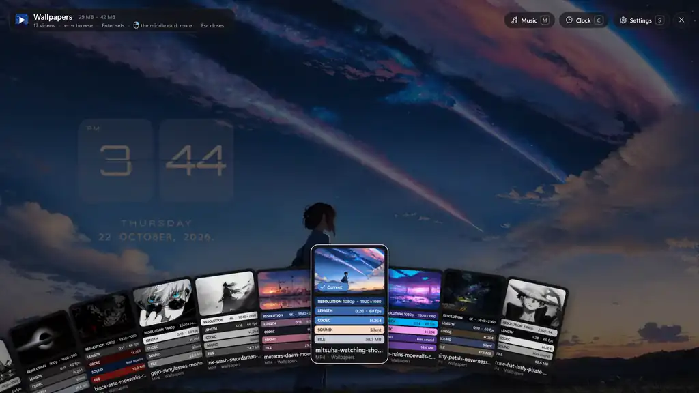

<p align="center">
  
</p>

<p align="center">
  <a href="https://github.com/Skyblock127/VideoBG/releases/latest"></a>
  <a href="https://github.com/Skyblock127/VideoBG/releases"></a>
  
  
</p>

<p align="center">
  <a href="https://github.com/Skyblock127/VideoBG/releases/latest"><b>⬇ Download the latest version</b></a>
  ·
  <a href="#update-to-a-new-version">How to update</a>
</p>

VideoBG plays a video behind your desktop icons, with a desktop clock and a music player. It's one
small exe: your graphics chip decodes the video, the wallpaper pauses when nobody can see it, and
turning it off stops the video completely.



## Features

- **Two looks:** a classic settings window, or the **modern look**: your wallpapers as a deck of
  cards over the full-screen wallpaper, with the clock and the music player editable right there.
- **Any video Windows can play:** MP4, MOV, MKV, WebM, AVI and more; animated GIFs are turned into a
  video once.
- **Light on your PC:** the GPU decodes, and the wallpaper pauses while apps cover the desktop, the
  PC is locked or the screen is off. **Versions** (screen size, 900p, 720p, 540p) use less memory.
- **Crop** the video to any part, and the **lock screen** shows a frame of it.
- **Desktop clock** in 13 styles (Mond in any font, Dial, Watch, Ring, Orbit, Flip, Digital, Stack,
  Line, Big, Bold, Calendar, Words), with your colour, size, glow, language and angle; presets too.
- **Music:** the video's sound or your own songs, with a playlist and a desktop player in nine styles
  that works as a remote. Media keys work, and the music never starts by itself with Windows.
- **Clear errors:** if a video won't play, VideoBG says why and how to fix it.

## Install

You'll need 64-bit Windows 10 or 11. No admin rights needed.

1. Download **VideoBG-&lt;version&gt;.zip** from the
   **[latest release](https://github.com/Skyblock127/VideoBG/releases/latest)**.
2. Right-click it, choose **Extract All**, and extract it somewhere it can stay, for example
   `C:\Tools` (you get `C:\Tools\VideoBG`; VideoBG runs from there).
3. Double-click **Install.cmd** in that folder. It adds VideoBG to the Start menu and your startup
   apps, then opens it.
   - If Windows says *"Windows protected your PC"*, click **More info**, then **Run anyway** (the
     app isn't code-signed).
4. Click **Choose video** and pick a video.

VideoBG then lives in the tray. Click its icon for the settings; right-click it for your wallpapers
(or the wallpaper on/off in the classic look), **Modern look**, **Settings** and **Exit**.

## Update to a new version

Click **Update** at the bottom left of the settings window (classic look). VideoBG checks GitHub,
then downloads the new version, puts it in place and restarts; your settings are kept. VideoBG
also looks for a new version each time it starts (and every few hours) and asks before updating.

Or by hand (no need to uninstall):

1. Download the new zip from the **[latest release](https://github.com/Skyblock127/VideoBG/releases/latest)**.
2. Right-click the tray icon and choose **Exit**.
3. Extract the zip to the same place as before (the folder that holds your VideoBG folder) and choose
   **Replace the files**.
4. Double-click **Install.cmd** again.

Your version is shown at the bottom left of the settings window; what changed is on the
[releases page](https://github.com/Skyblock127/VideoBG/releases).

## Uninstall

Double-click **Uninstall.cmd** in the VideoBG folder. It puts your own lock screen picture back and
asks whether to delete your settings too. Then delete the folder.

## How to use

The **hotkey** (`Ctrl + Alt + B` by default) turns the wallpaper on or off in the classic look, and
brings up your wallpapers in the modern look.

| Page | What you can do |
|---|---|
| **Video** | **Choose video**, or pick from **Your wallpapers**. **Crop** it, pick the lock screen frame with the **Preview** slider, and make lighter **Versions**. |
| **Playback** | Speed, a frame-rate cap and which displays to use. On laptops with two graphics chips, **iGPU** keeps the video's frames in your RAM and **dGPU** in its own memory (more power). **Power saving**: pause when apps cover the desktop, and what to do on battery. |
| **Clock** | Drag the clock on the preview to place it, and turn it with the handle above it. Pick its style, colours (with an eyedropper), size, opacity, glow, date, language and 12/24-hour time. Set it for the video wallpaper and the still one, or give one video its own clock. **Presets** keep up to 5 looks. |
| **Music** | Nothing, the video's sound, or **My music**: play/pause, seek, previous/next, shuffle and repeat, and a playlist (click **Playlist** to find the song playing; search it, drag songs to reorder, **×** to remove; **Add songs** or **Choose songs**). **Player** puts a music player on your desktop and sets its style, colours, opacity, size, corners and angle; **Done** keeps them. On the desktop its buttons, volume and song position work. |
| **Settings** | The hotkey and the **pause / mute sound** shortcut (Pause/Break by default; works in games), whether the wallpaper starts on, your data folders, and **Feedback** (an idea or a problem report, with up to 3 pictures; no account needed). |

### Modern look

Switch at the top of the settings (**Classic** / **Modern**). The hotkey (or the tray icon) brings
your wallpapers up as a deck of cards over the full-screen wallpaper; the wallpaper's RAM and the
tray app's show next to the title.

- **Browse** with the wheel, a touchpad, a drag or the arrow keys: each card's picture shows at once,
  and its video starts after a moment.
- **Enter** or a click on the middle card makes it your wallpaper; **Esc** keeps the one you had.
- **Right-click the middle card** to take it off the list, pick which **version** plays, or **crop**
  your wallpaper right on the screen.
- **Clock** (**C**): edit the video's clock over it: drag it, turn it by its handle, and change
  everything in the panel beside it. **Save** keeps it; **Esc** doesn't.
- **Music** (**M**): the desktop player sits where it is on your desktop and works as the remote; drag
  it, turn it, and change its look beside it, plus your playlist. **Done** keeps the look; **Esc**
  doesn't. With no player, play, seek and volume show in the middle instead.
- **Settings** (**S**): add videos, the lock screen, the wallpaper off, or all the settings.

While open, the modern look uses about 170 MB of memory (RAM and graphics memory together), against
about 45 MB for the classic window; both give it back when they close.
`VideoBG.exe --wallpapers` opens the wallpapers from a shortcut.

**Keyboard:** in the settings window, **Tab** moves between controls, **Enter** or **Space** uses one,
the **arrow keys** move sliders, the clock and the crop box, and **Esc** lets go (again to close). In
the modern look, the arrow keys browse, nudge the clock and move the crop box; on Music, **↑ ↓**
move over the songs and **Tab** goes round the controls.
To stop starting with Windows: **Windows Settings > Apps > Startup**.

## If a video won't play

VideoBG shows the reason and the fix on the Video page. Usually Windows is missing a codec:

| Video | Install this, then come back to VideoBG |
|---|---|
| AV1 (common in 4K YouTube downloads) | [AV1 Video Extension](https://apps.microsoft.com/detail/9MVZQVXJBQ9V) (free) |
| VP9 (common in WebM) | [VP9 Video Extensions](https://apps.microsoft.com/detail/9N4D0MSMP0PT) (free) |
| HEVC / H.265 (phones, cameras) | [HEVC Video Extensions](https://apps.microsoft.com/detail/9NMZLZ57R3T7) (small fee) |
| MPEG-2 (DVDs, older recordings) | [MPEG-2 Video Extension](https://apps.microsoft.com/detail/9N95Q1ZZPMH4) (free) |

The wallpaper starts again by itself once the codec is installed.

## Building from source

You'll need [MinGW-w64](https://www.mingw-w64.org/) with g++ and windres on PATH.

```powershell
.\build.ps1 -Zip    # dist\VideoBG.exe and dist\VideoBG.zip
.\install.ps1       # run VideoBG from this folder: Start menu shortcut and startup entry
```

To redraw the icons and banner, run `tools\make_icons.py` and `tools\make_banner.py` (Python with
Pillow).

